# Meta 3.1 - API REST con Express - Gestión de Tareas (MVC)

El presente proyecto presenta una API REST de gestión de tareas que cuenta con un CRUD completo para guardar las tareas en memoria y gestionarlas mediante funciones básicas: listar, buscar, crear, actualizar y eliminar.

## Instrucciones de instalación y ejecución

Para instalar el proyecto, primero hay que obtener el mismo directamente del respositorio en github.

```Shell
git clone https://github.com/alexTorres2240/web-meta-3.1.git
```

Después, hay que instalar las dependencias del proyecto.

```Shell
npm install
```

Finalmente, se inicia el servidor.

```Shell
npm run dev
npm start
```

## Métodos y Endpoints disponibles

En la siguiente tabla se presentan los endpoints disponibles para cada método junto a una breve descripción.

| Método | Endpoint                   | Descripción                        |
| ------- | -------------------------- | ----------------------------------- |
| GET     | /                          | Mensaje de bienvenida.              |
| GET     | /api/tareas                | Obtiene todas las tareas.           |
| GET     | /api/tareas/buscar?q=texto | Busca tareas por título.           |
| GET     | /api/tareas/:id            | Obtiene una tarea por ID.           |
| POST    | /api/tareas                | Crea una nueva tarea.               |
| PUT     | /api/tareas/:id            | Reemplaza una tarea completa.       |
| PATCH   | /api/tareas/:id            | Actualiza solo los campos enviados. |
| DELETE  | /api/tareas/:id            | Elimina una tarea.                  |

## Capturas de pantalla

A continuación se muestran capturas de pantalla de los resultados para cada petición en test-collection.http.

```HTTP
GET {{host}}/
```

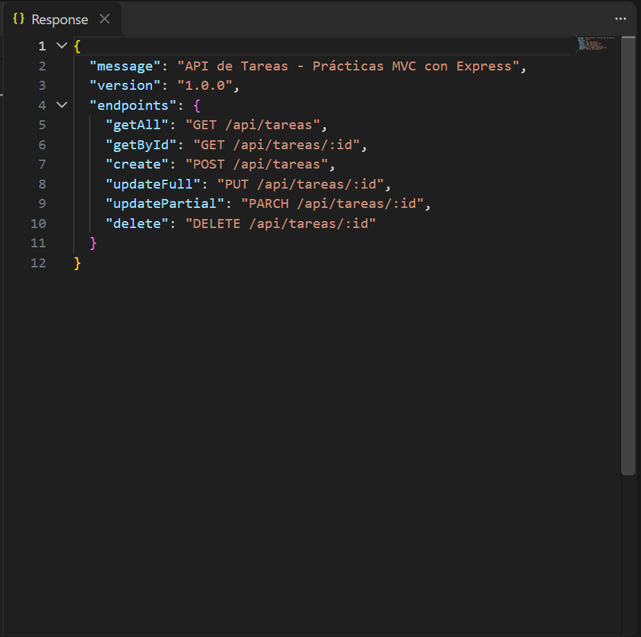

```HTTP
GET {{host}}/api/tareas?formato=text
```

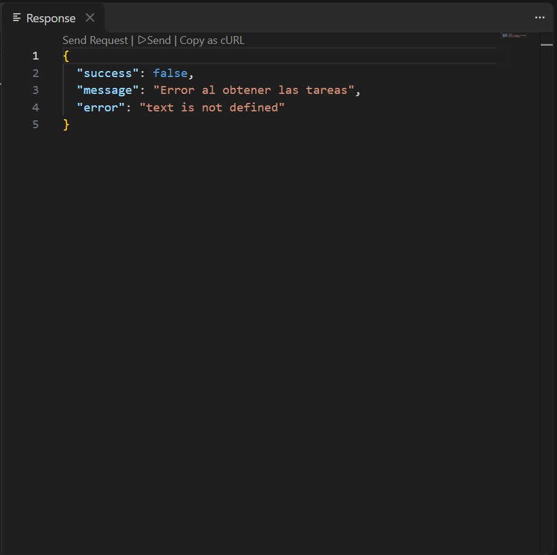

```HTTP
GET {{host}}/api/tareas
```

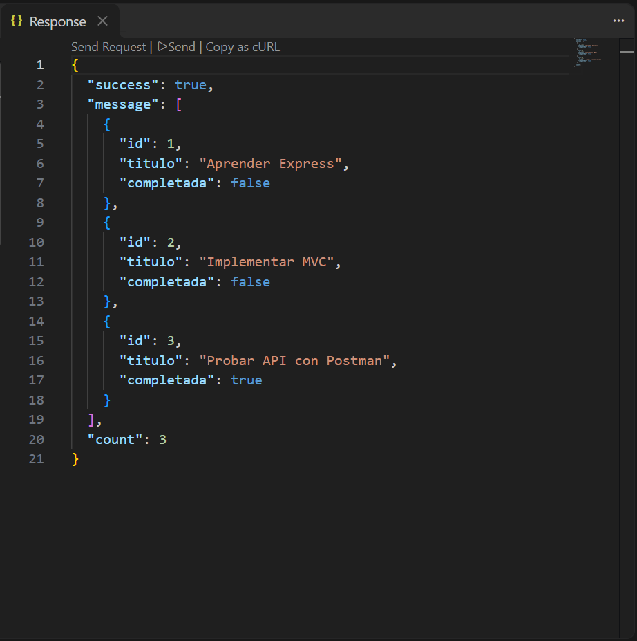

```HTTP
GET {{host}}/api/tareas/1
```

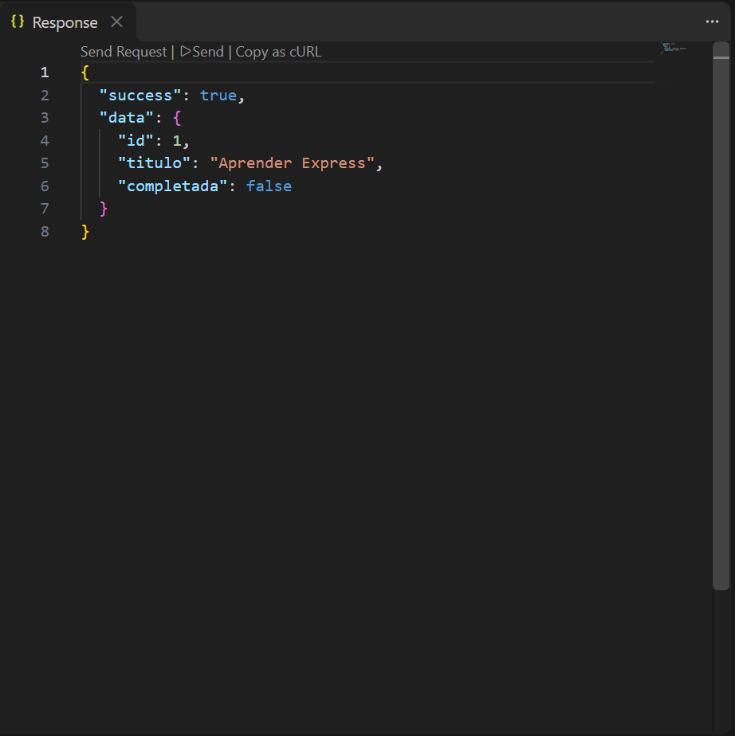

```HTTP
POST {{host}}/api/tareas

Content-Type: application/json

{
    "titulo": "Nueva tarea",
    "completada": false
}
```

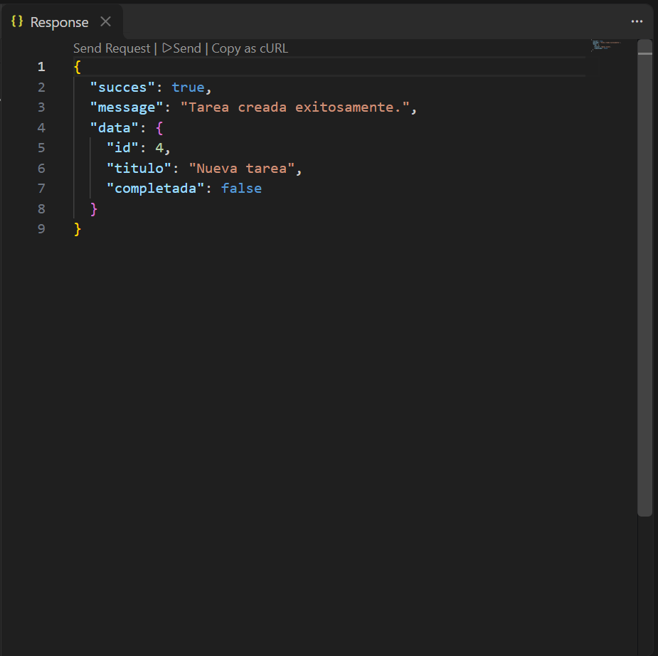

```HTTP
PUT {{host}}/api/tareas/1

Content-Type: application/json

{
    "titulo": "Tarea actualizada",
    "completada": true
}
```

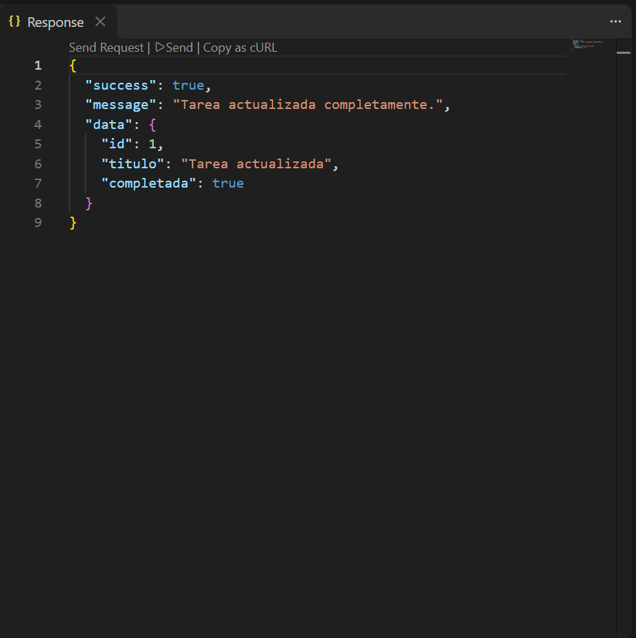

```HTTP
PATCH {{host}}/api/tareas/1

Content-Type: application/json

{
    "completada": false
}
```

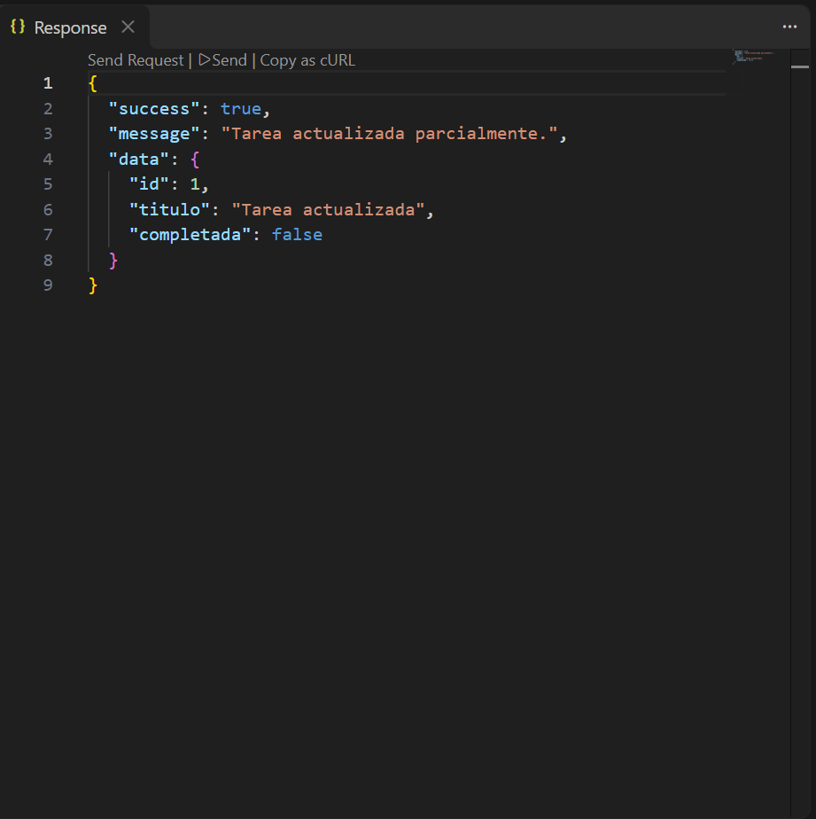

```HTTP
GET {{host}}/api/tareas/buscar?q=express
```

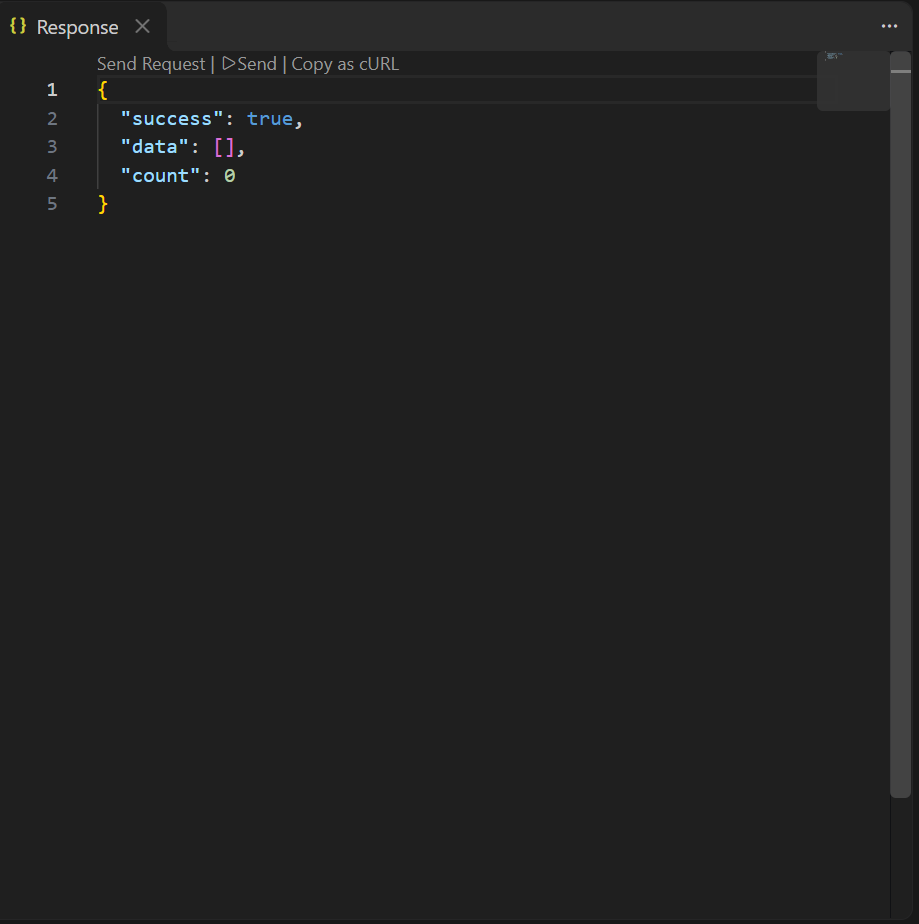

```HTTP
GET {{host}}/api/tareas/buscar?q=EXPRESS
```

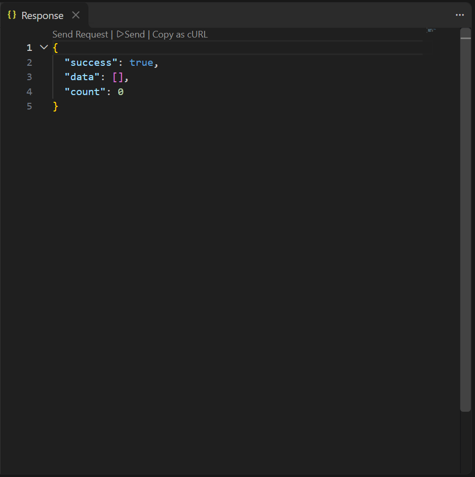

```HTTP
GET {{host}}/api/tareas/buscar
```

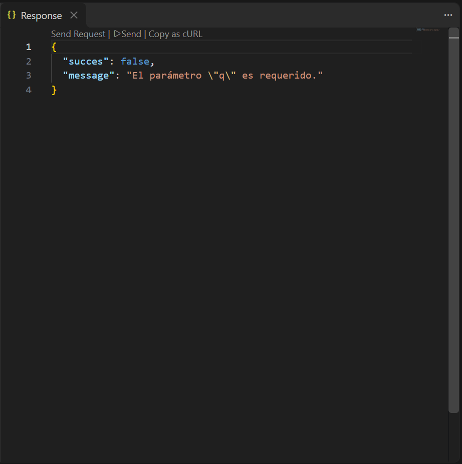

```HTTP
DELETE {{host}}/api/tareas/3
```

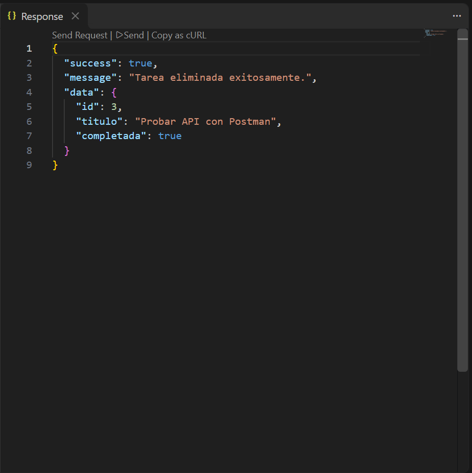
